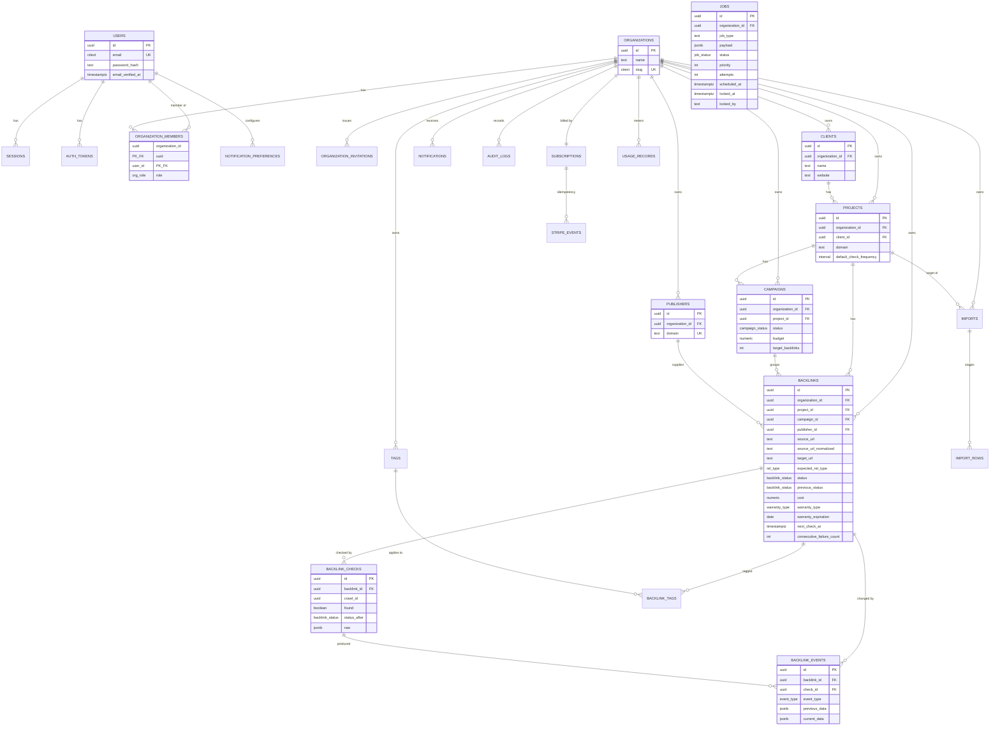

# 04 — Entity Relationship Diagram

**Spec ref:** §56.6. Field definitions live in [03-database-schema.md](03-database-schema.md).

## Tenant hierarchy (§18)

```
User ──┬── OrganizationMember ──┬── Organization
       │      (role)            │
       │                        ├── Client
       │                        │     └── Project
       │                        │           ├── Campaign
       │                        │           └── Backlink ──┬── BacklinkCheck
       │                        │                          └── BacklinkEvent
       │                        ├── Publisher ─────────────┘ (backlinks reference)
       │                        ├── Tag ── BacklinkTag ────┘
       │                        ├── Import ── ImportRow
       │                        ├── Subscription ── UsageRecord
       │                        ├── Notification
       │                        └── AuditLog
       └── Session / AuthToken / NotificationPreference
```

A user belongs to **many** organizations (§18). `organization_members` is the join, and it carries
the role — a user can be an `owner` of one org and a `viewer` of another.

## Full ERD



`JOBS` is drawn unattached on purpose: it references `organization_id` for observability and quota
attribution, but it is infrastructure, not part of the domain graph. A job referencing a deleted
organization is tolerable; a backlink referencing a deleted project is not.

## Cardinality notes

- `Organization` → `Subscription` is **1:1**. An org has exactly one billing relationship.
- `Backlink` → `Campaign` and `Backlink` → `Publisher` are **optional**. A link can exist before it
  is attributed to either, which is what CSV import produces on day one.
- `BacklinkCheck` → `BacklinkEvent` is 1:many and optional — most checks produce **no** event. That
  is the normal, healthy case, and it is why events are a separate table rather than a flag on
  checks.
- `Project` → `Client` is optional, so a solo consultant (§2) never has to invent a client record
  to get started.
